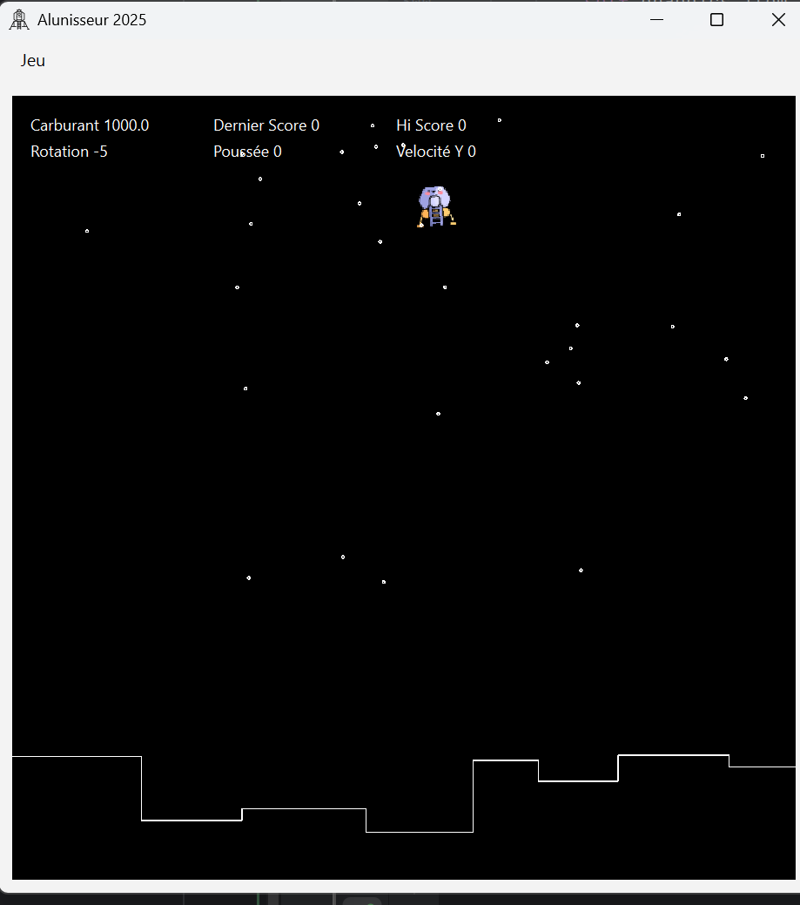

# 420-SF3-RE - Automne 2026 - Travail Pratique 2

# Alunisseur
Parmi les classiques des jeux rétros se trouve le jeu "Moonlander". Nous allons recréer une version
de ce jeu en utilisant les QGraphics pour l'affichage et la détection de collisions. D'autres notions seront aussi
utilisées comme la gestion des événements clavier et les transformations sur les QGraphics.

## Survol de l'application
"Moonlander" est un jeu où un module lunaire doit atterrir sur une surface générée au hasard. Le module descend
constamment, mais le joueur peut utiliser des propulseurs pour exercer une poussée vers une direction.
Il y a généralement trois propulseurs, deux latéraux et un principal à la base du module. Les propulseurs latéraux
sont habituellement excentrés pour créer une rotation du module.

## Termes
- HUD: *Head-Up Display* (affichage tête haute): Terme utilisé pour représenter les informations affichées dans le champ visuel
de l'utilisateur (ex: score, carburant restant, rotation, etc)

## Survol des classes

### AlunisseurApp (20 points)
- Fenêtre principale (QMainWindow) : crée l'interface, la QGraphicsView, la barre de menu et le QTimer.
- Vue et Contrôleur
- Méthodes clés : 
  - ``__init__``: initialisation UI et démarrage du timer
  - ``nouvelle_partie()``: réinitialise la partie
    - doit créer une nouvelle instance de AluniseurJeu et générer sa scene
    - met l'état du jeu à ``EN_COURS`` pour débuter la partie
  - ``boucle_jeu()``: boucle périodique liée au timer qui applique les commandes et met à jour le jeu
    - appelé à chaque 200ms par le QTimer, va appeler des méthodes basées sur l'état actuel du jeu 
  - ``keyPressEvent() / keyReleaseEvent()``: gestion des touches A/D/W et P pour pause
    - Utilisé pour gérer si un joueur tient une touche
      - ``A`` rotation anti-horaire
      - ``D`` rotation horaire
      - ``W`` Applique une poussée du propulseur
        - À chaque mise-à-jour, l'amplitude de poussée sera ajoutée à la poussée courante
        - Si l'utilisateur cesse de peser sur la touche, la poussée courante redevient 0
    - ``P``
      - Lorsque pesé, met en pause le jeu
      - Lorsque pesé de nouveau, reprend l'exécution du jeu
- Doit aussi implémenter un menu avec les QAction suivante
  - ``Nouvelle partie``
    - doit appeler la méthode ``nouvelle_partie()`` pour débuter une nouvelle partie
  - ``Configuration``
    - Doit présenter une interface graphique à votre choix pour modifier les propriétés de votre objet ``ConfigAlunisseurJeu``
  - ``Quitter``
    - Quitter l'application
    - Il doit y avoir un séparateur avant le menu ``Quitter``
- Ajouter un titre et une icône à l'application
  - Titre et icône de votre choix

### ConfigAlunisseurJeu (5 points)
- Contient les paramètres de configuration du jeu
  - ``nb_etoiles``: nombre d'étoiles de type ``Etoile`` générées sur la scène
  - ``force_gravitationnelle``: vélocité vers le bas appliquée à chaque mise-à-jour du jeu
  - ``amplitude_rotation``: de combien de degré la rotation est modifiée à chaque mise-à-jour si la touche est maintenue
  - ``amplitude_poussee``: grandeur du vecteur de la poussée appliquée pour calculer la vélocité en x et en y
  - ``hi_score``: score le plus ayant été atteint après des parties successives
  - ``dernier_score``: score de la dernière partie
  - ``carburant_initial``: le carburant au début de la partie, défaut: 1000

### AlunisseurJeu (30 points)
- Modèle principal du jeu : maintient l'état (Etat), scores, paramètres, références aux objets graphiques (alunisseur, sol, étoiles, HUD).
- Méthodes clés :
  - ``__init__(configuration: ConfigAlunisseurJeu)``: initialise une nouvelle à partir des propriétés contenues dans l'objet de type ConfigAlunisseurJeu
  - ``generer_nouveau_jeu()``: construit la QGraphicsScene, crée et ajoute les items
    - La scene doit utiliser un arrière-plan d'une couleur autre que celle par défaut (i.e. doit utiliser un fill()) ou un PixMap d'arrière-plan.
    - ajoute le ``Sol``
    - ajoute l'alunisseur
      - position initiale
        - x: aléatoire entre 275 et 325
        - y: aléatoire entre 50 et 75
    - ajoute les items du HUD
      - Doit être en blanc
      - Peut être stylisé en utilisant du HTML ou lieu de texte plein
    - ajoute le nombre d'étoiles aléatoirement
      - plus beau si on utilise random.uniform()
      - doivent être générées dans l'espace:
        - x: à au moins 10 pixels des côtés de la scène
        - y: entre 10 et 375 
  - ``mettre_a_jour()``: physique basique : calcul des vitesses et déplacement de l'alunisseur
    - calcul des vélocités en x et en y de l'alunisseur
      - ``velocite_x``: composante en x de la poussée courante calculée en utilisant la direction
      - ``velocite_y``: composante en y de la poussée courante calculée en utilisant la direction de laquelle 'on soustrait la ``force_gravitaionnelle``
      - mise-à-jour de la position de l'alunisseur en utilisant les vélocités
        - ne doit pas dépasser les bords de la scène (ne doit pas disparaître en haut, à gauche ou à droite)
  - ``mettre_a_jour_hud()``: met à jour les textes du HUD
    - mise-à-jour des valeurs affichées par le HUD
  - ``verifier_collisions()``: teste les collisions et décide crash/gain
    - vérifier s'il y a une collision avec le ``Sol``
      - S'il y a une collision:
        - Si la vélocité en y est plus petit que -50, l'alunisseur atterri trop vite et s'écrase
          - Le joueur a perdu
          - Afficher une nouvelle "Scene" lui indiquant qu'il a perdu (écran Game Over) 
        - Sinon, il réussi son atterrissage
          - Le joueur a gagné
          - Afficher une nouvelle "Scene" de victoire pour le féliciter en indiquant son score
            - Son score est la quantité restante de carburant
          - Le design de la "Scene" est laissé à votre discrétion
            - Possibilité de points bonus pour quelque chose hors de l'ordinaire
  - ``Etat``: classe interne contenant des variables de classe pour l'état du jeu 
    - ``PRÊT``: nouveau jeu initialisé, prêt à débuter
    - ``EN_COURS``: jeu en cours d'exécution
    - ``PAUSE``: jeu mis en pause
    - ``TERMINE``: jeu terminé après que le joueur a soit fait un "crash" ou a gagné
    

### Alunisseur (20 points)
- Représente le vaisseau : 
  - propriétés physiques
    - direction
      - direction du vaisseau en degré, généré aléatoirement entre -25 et 35
      - le QGraphicsPixmapItem devra être rotationné de l'angle de la direction
      - la rotation doit se faire à partir du point central du Pixmap et non du coin supérieur gauche comme par défaut
        - Il existe une méthode pour changer l'origine de la rotation
    - poussee
      - poussée courante du vaisseau, défaut 0
    - carburant
      - quantité de carburant restant
      - nécessaire pour la poussée
      - sert aussi pour le score
      - défaut 1000
    - velocite_x
      - vélocité en x utilisée pour déplacer le vaisseau 
    - velocite_y
      - véliocité en y utilisée pour déplacer le vaisseau
    - ampleur_poussee
      - ampleur de l'ajout de la poussée à la poussée courante lorsque l'utilisateur "accélère"
    - ampleur_rotation
      - ampleur de la rotation lorsque le joueur effectue une "rotation"
  - l'item graphique (QGraphicsPixmapItem)
    - Utiliser un pixmap de 32x32
      - Vous pouvez utiliser votre propre image ou "scaled()" l'image fournie
  - Initialise le pixmap redimensionné, fixe l'origine de transformation au centre pour permettre la rotation centrée.
  - Méthodes clés: 
    - ``accelerer()``: modifie la poussée et le carburant
      - Ajoute l'amplitude de la poussée à la poussée courante s'il y a du carburant disponible
      - On soustrait du carburant l'amplitude de la poussée utilisée 
    - ``rotation(sens_horaire: bool)``: modifie la direction et la rotation graphique
      - Applique la rotation d'une valeur de l'amplitude de rotation

        
### Sol (10 points)
- Génère un terrain aléatoire sous forme de QPainterPath et l'encapsule dans un QGraphicsPathItem avec un QPen blanc.
- Sert de collision solide pour l'alunisseur.
- Le sol est constitué de plusieurs plateformes
  - Les plateformes doivent être de
    - largeur aléatoire entre 50 et 100, à moins d'être la dernière plateforme générée (prend le reste de la largeur de l'écran)
    - situé à une hauteur aléatoire entre 490 et 590
    - doivent être reliées entre elles par des lignes
- Doit être en blanc ou une couleur visible

### HudItem (10 points)
- Wrapper pour un QGraphicsTextItem : crée l'item texte et définit sa couleur par défaut (blanc).
- Utilisé pour afficher:
  - carburant
  - Dernier Score
  - Hi Score
  - Rotation
  - Poussée
  - Vélocité Y
- Doit être placé dans le haut
- Non collisionnable
- Doit être en blanc ou une couleur visible

### Etoile (5 points)
- Petit point visuel (QGraphicsEllipseItem) représentant une étoile de fond ; non collisionnable
- Doit être en blanc ou une couleur visible
- Vous pouvez choisir la largeur

## Instructions
- Implémenter toutes les classes et méthodes décrites ci-haut
- ``AlunisseurApp`` doit être dans le module ``alunisseur_app.py``
  - Toutes les autres classes doivent être dans des modules séparés.
- Pour ce TP, vous avez le droit de modifier les signatures de méthodes
  - Attention: si votre code devient bizarrement structuré ou incompréhensible, des point seront déduits
  - Les commentaires sont toujours utiles
  - L'encapsulation est obligatoire pour toutes les propriétés accédées à l'extérieur de la classe  

## Évaluation
- Voir les barêmes entre parenthèses 
- Des points seront retirés si:
  - PEP-008 non-respectés
  - Manque de commentaires
  - Non-respect des conventions de nommage
  - Trop de bugs rendant le jeu non-fonctionnel
  - Code mal structuré
- En équipe de 2 ou 3 personnes
  - Aucun travail solo accepté
- Vaut pour 20% de la note finale 

## Points Bonis
- Des possibilités de points bonis pourraient être communiquées d'ici la remise du TP
- Vous pouvez ajouter des fonctionnalités supplémentaires en autant que celles requises soient respectées
  - Ces fonctionnalités de votre cru pourraient faire l'objet de points bonis
  - Si la modification d'un requis fonctionnel obligatoire est nécessaire pour une fonctionnalité "cool", me contacter par MIO.

## Suspicion d'utilisation de l'IA
Si je suspecte que l'IA a été utilisée en partie pour le code, je me réserve le droit de convoquer l'équipe et
l'équipe devra être en mesure d'expliquer le code.